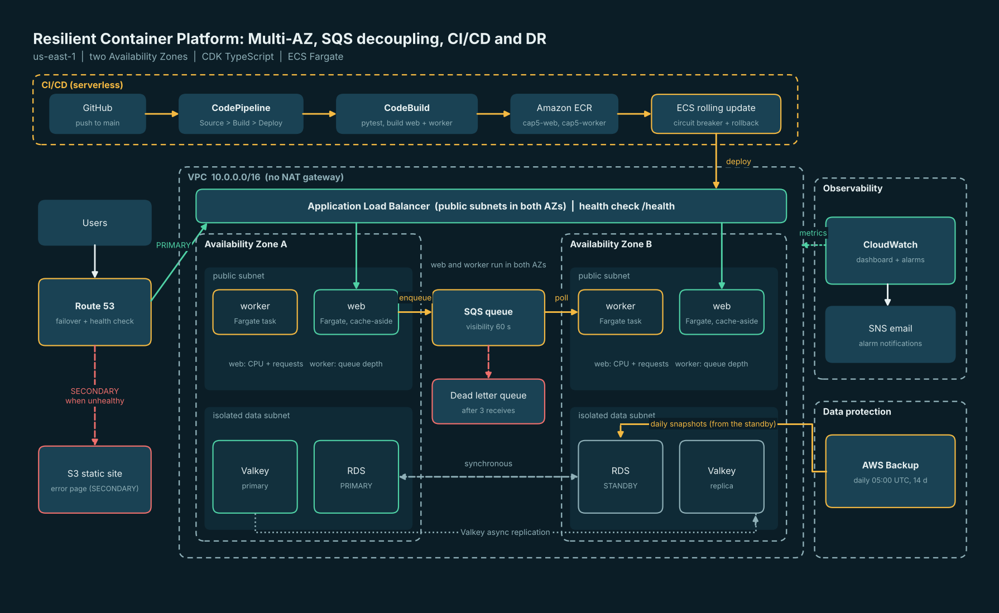

# Capstone 5: Resilient Container Platform and CI/CD

An e-commerce style platform on Amazon ECS Fargate that survives the loss of an Availability Zone, absorbs traffic spikes through a queue, protects its data with AWS Backup, degrades to a static page when the cluster is down, and ships itself through CodePipeline.

Everything is defined as code (AWS CDK, TypeScript) and deployed to `us-east-1`.

## Architecture



| Concern | Implementation |
|---|---|
| Compute | ECS Fargate cluster, tasks spread over 2 AZs. Two services: `web` (Flask behind the ALB) and `worker` (SQS consumer) |
| Entry | Application Load Balancer in both AZs, health check on `/health` |
| Database | RDS PostgreSQL 18, Multi-AZ, encrypted, isolated subnets, credentials in Secrets Manager injected as ECS secrets |
| Cache | ElastiCache for Valkey replication group, primary and replica in different AZs, automatic failover, TLS and encryption at rest. Cache-aside in the web app with a 30 second TTL that fails open to the database |
| Decoupling | SQS standard queue with a dead letter queue (3 receives). `POST /api/orders` stores the order and enqueues it, the worker completes it |
| Scaling | Web: target tracking on CPU (60 percent) and ALB requests per target (200), 2 to 6 tasks. Worker: target tracking on `ApproximateNumberOfMessagesVisible` (target 10), 1 to 10 tasks |
| Backup | AWS Backup vault and plan defined in CDK, daily at 05:00 UTC, 14 day retention, selects the RDS instance |
| DR routing | Route 53 failover records on a delegated subdomain. PRIMARY is an alias to the ALB with a health check, SECONDARY is an alias to an S3 static website |
| CI/CD | CodePipeline v2 with a GitHub connection, one CodeBuild project (tests, builds both images, pushes to ECR), two ECS deploy actions (rolling update with circuit breaker rollback) |
| Observability | Container Insights, CloudWatch dashboard `cap5-platform`, four alarms to SNS email |

### Design decisions

* **No NAT gateway.** Tasks run in public subnets with a public IP and only accept traffic from the ALB security group. The data tier sits in isolated subnets with no internet route. This saves about $33 a month per NAT gateway. A production deployment would move tasks to private subnets with NAT or VPC endpoints.
* **`/health` is shallow, `/ready` is deep.** Route 53 and the ALB use `/health`. If it checked the database, a normal RDS failover would pull the whole site out of DNS. `/ready` reports database, cache and queue state for humans and for deployment checks.
* **Cache fails open.** A cache outage costs latency, not availability.
* **Idempotent worker.** Standard SQS delivers at least once, so the worker skips orders that are already `COMPLETED`.
* **Graceful shutdown.** The worker handles SIGTERM and the container has a 60 second stop timeout, so rolling updates and scale-in never drop in-flight messages.
* **Plain HTTP.** The demo uses no certificate. S3 website endpoints are HTTP only, so the failover record would need CloudFront to serve HTTPS. Documented as a limitation below.

## Repository layout

```
app/                 Web app and SQS worker (Dockerfiles, shared code, pytest suite)
  common/            Settings, PostgreSQL pool with failover retry, cache, SQS wrapper
  web/               Flask application and Dockerfile
  worker/            Queue consumer and Dockerfile
  tests/             17 unit tests using in-memory fakes
pipeline/
  buildspec.yml      CodeBuild: test, build both images, push, emit imagedefinitions files
infrastructure/      AWS CDK (TypeScript)
  lib/               Foundation, Platform and Pipeline stacks plus constructs
  test/              20 CDK assertion tests
dr/index.html        Static error page served by the SECONDARY failover record
scripts/             bootstrap_images, load_queue, status, simulate_failover, rds_failover, backup_now, teardown
docs/                Architecture diagram, DR runbook, screenshots
```

## Deploy guide

Prerequisites: an AWS account, AWS CloudShell, a GitHub connection in `AVAILABLE` state (Developer Tools, Settings, Connections), and a DNS zone you can add NS records to. Cost while running is about $0.20 per hour.

### 1. Get the code and set variables

```bash
git clone https://github.com/GIOVESS/aws-capstone-five.git
cd aws-capstone-five/infrastructure
npm install
export ALERT_EMAIL=you@example.com
export ZONE_NAME=cap5.example.com
export ACCOUNT_ID=$(aws sts get-caller-identity --query Account --output text)
npx cdk bootstrap aws://$ACCOUNT_ID/us-east-1
```

`ZONE_NAME` is a subdomain you control. The stack creates a Route 53 hosted zone for it and the site is served at `shop.<ZONE_NAME>`.

### 2. Foundation (ECR) and first images

```bash
npx cdk deploy Cap5Foundation --require-approval never
cd ..
./scripts/bootstrap_images.sh
```

### 3. Platform

```bash
cd infrastructure
npx cdk deploy Cap5Platform --require-approval never
```

This takes 20 to 30 minutes (RDS Multi-AZ and the cache dominate). Confirm the SNS subscription email, then check it shows a real ARN:

```bash
aws sns list-subscriptions --query 'Subscriptions[?contains(TopicArn,`Cap5Platform`)].[SubscriptionArn]' --output text
```

### 4. Delegate the subdomain

Print the four name servers and add them as NS records for the subdomain at your DNS provider:

```bash
aws cloudformation describe-stacks --stack-name Cap5Platform \
  --query "Stacks[0].Outputs[?OutputKey=='NameServers'].OutputValue" --output text
```

Verify with `dig NS $ZONE_NAME +short`, then open the `SiteUrl` output.

### 5. Pipeline

```bash
export CONNECTION_ARN=$(aws codeconnections list-connections --query "Connections[?ConnectionStatus=='AVAILABLE'].ConnectionArn | [0]" --output text)
npx cdk deploy Cap5Pipeline --require-approval never
```

Pushing to `main` starts the pipeline. Build and deploy take about 8 minutes.

## Evidence

Behaviour is described as planned first and observed second. Items marked pending are filled after the live run.

### CI/CD proof

Pending: screenshot `docs/screenshots/01-pipeline-success.png` of a successful CodePipeline execution (Source, Build, Deploy web, Deploy worker).

### Scaling proof

Drill: `python3 scripts/load_queue.py --count 3000 --seconds 3`, then watch the `cap5-platform` dashboard.

Planned: queue depth rises, target tracking adds worker tasks up to 10, depth drains, tasks scale back in.

Pending: screenshot `docs/screenshots/02-worker-scaling.png` and observed task counts and timings.

### AWS Backup plan

Planned: vault `cap5-vault`, plan `cap5-daily`, rule `daily-rds` at 05:00 UTC, 14 day retention, resource selection `cap5-rds`.

Pending: screenshots `03-backup-plan.png` and `04-backup-job.png` from `./scripts/backup_now.sh`.

### Failover proof

Route 53 drill: `./scripts/simulate_failover.sh down`, `watch`, then `up`.

RDS drill: `./scripts/rds_failover.sh`.

Pending: screenshots `05-route53-failover.png`, `06-error-page.png`, `07-rds-failover.png` and the observed timings.

The full procedure for each failure is in [docs/DR_RUNBOOK.md](docs/DR_RUNBOOK.md).

## Tests

```bash
cd app && pip install -r requirements-dev.txt && python -m pytest -q     # 17 tests
cd infrastructure && npm test                                            # 20 tests
```

CodeBuild runs the application tests before building images, so a failing test stops the pipeline.

## Teardown

```bash
export ALERT_EMAIL=you@example.com
export ZONE_NAME=cap5.example.com
./scripts/teardown.sh
```

The script destroys the pipeline, deletes backup recovery points (a vault with recovery points cannot be deleted), then the platform and foundation stacks. Afterwards remove the NS records at your DNS provider. The `CDKToolkit` bootstrap stack and its bucket are shared and can stay.

## Limitations and next steps

* HTTP only. Production would add ACM certificates on the ALB and CloudFront in front of the S3 failover page.
* Tasks have public IPs to avoid NAT cost. Production would use private subnets.
* Queue depth is a simple scaling signal. Backlog per task is more precise for workloads with variable processing time.
* Backups are same-region. Cross-region copy and a read replica would extend the design to regional failure.
* A platform deploy that changes a task definition resets that service to the `bootstrap` image. Run the pipeline again afterwards, or set `IMAGE_TAG` to a tag that exists in ECR.
* The git short SHA is baked into each image as `APP_VERSION`, so the page and `/health` show which release is serving.
